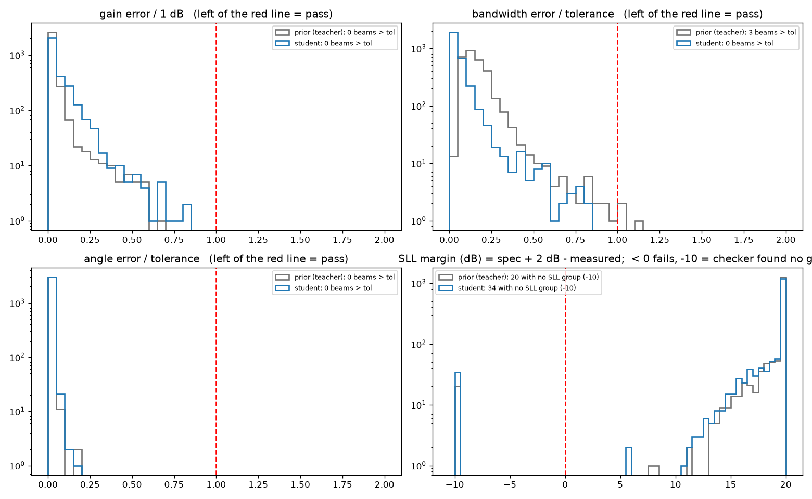
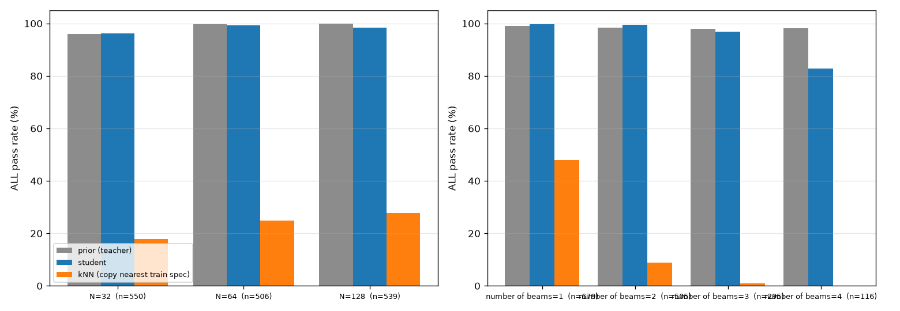

# Beamforming Student Network

A neural network (student) that maps a beamforming spec
(array size, beam angles/widths/gains, nulls, SLL) to complex
element weights in about 4 ms, distilled from an analytic prior (teacher).

## Results
- Overall pass rate about 98% on 1595 unseen test specs (teacher about 98.6%)
- Weakest case: 4 beams (about 83%)
- kNN baseline: 1-48%, so the student generalizes instead of memorizing




## Usage
```
pip install -r requirements.txt
python demo_student.py          # random test spec
python demo_student.py pass     # a passing spec
python demo_student.py fail     # a failing spec
python demo_student.py 123      # test row 123
```

## Files
- `bf_common.py`: shared beamforming functions and the exact checker
- `make_prior_dataset.py`: builds the dataset
- `train_student.py`: trains the student network
- `evaluate_student.py`: evaluation plots and pass rates
- `demo_student.py`: runs the trained student on one test spec
- `prior_dataset_v2.npz`: dataset
- `beamforming_student_v2.weights.h5`: trained weights